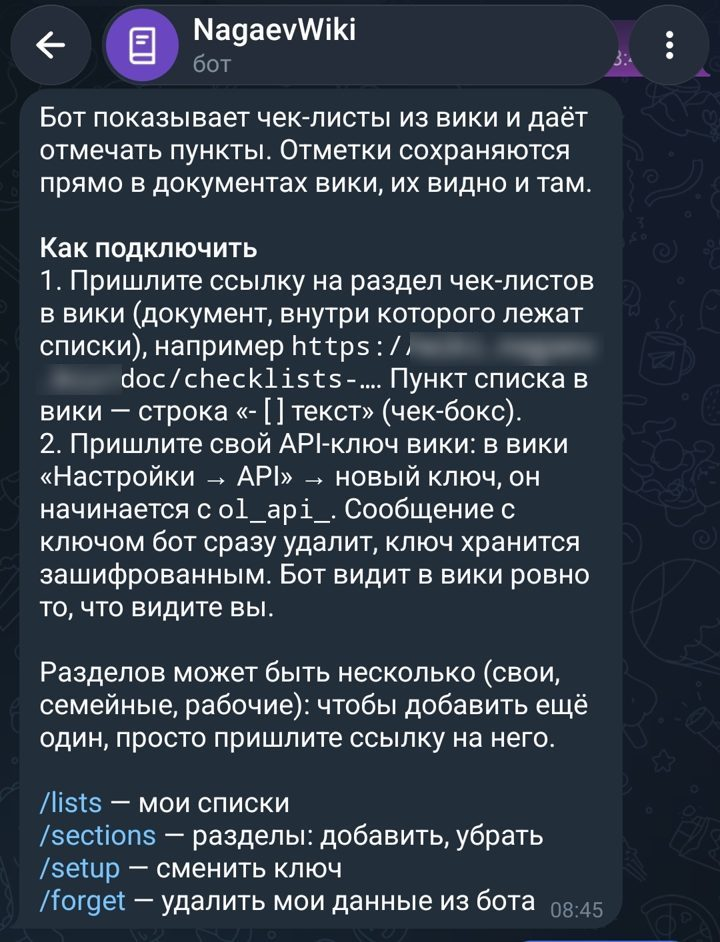
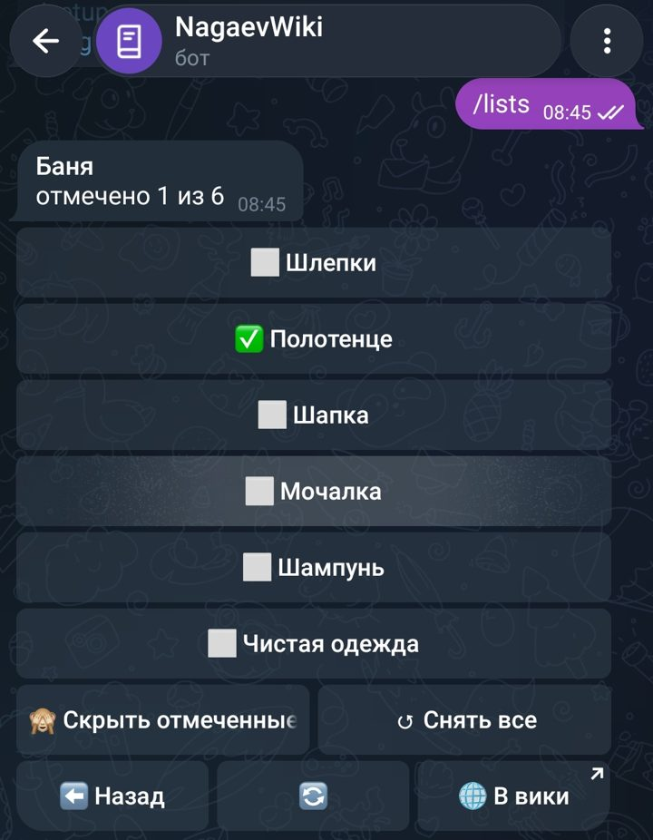

# Чек-листы в Telegram: инструкция для пользователя

Бот показывает ваши чек-листы из вики и даёт отмечать пункты прямо в Telegram: что собрано, что нет. Отметки сохраняются в самой вики, поэтому список выглядит одинаково и в боте, и в браузере.

## 1. Подготовьте списки в вики

1. Создайте документ-раздел, например **«Checklists»**. Можно в общей коллекции или в личной.
2. Внутри него создайте по документу на каждый список: «В поездку», «Дела по дому», «Командировка»…
3. Пункты делайте чек-боксами. В редакторе вики наберите `[]` и пробел в начале строки или выберите «Список задач» в меню `/`. В тексте документа это строка `- [ ] пункт`.
4. По желанию разбейте длинный список заголовками («Документы», «Одежда»). В боте они станут разделителями.

Внутри списка можно делать вложенные разделы: документ с дочерними документами откроется в боте как папка.

## 2. Создайте ключ API

1. В вики откройте **Настройки → API** (в некоторых версиях «API и приложения»).
2. Нажмите **«Новый ключ»**, назовите его, например, «Telegram», и задайте срок действия по желанию.
3. Скопируйте ключ. Он начинается с `ol_api_` и показывается один раз.

Если пункта API в настройках нет, создание ключей выключено администратором вики. Попросите его включить.

## 3. Подключите бота

1. Найдите бота в Telegram (имя спросите у администратора) и нажмите **Старт**.
2. Пришлите ссылку на свой раздел чек-листов: откройте документ «Checklists» в браузере и скопируйте адрес вида `https://<вики>/doc/checklists-AbCdEf1234`.
3. Пришлите ключ API. Бот сразу удалит это сообщение из чата.

Ссылку и ключ можно прислать в любом порядке или одним сообщением. После этого бот покажет ваши списки.

## Несколько разделов

Можно подключить несколько разделов, например свой «Checklists», семейный «Покупки» и рабочий «Командировки»: просто пришлите боту ссылку на ещё один раздел. Ключ второй раз присылать не нужно.

- **/lists** при нескольких разделах открывает меню разделов, при одном — сразу сам раздел.
- Кнопка **📚 Разделы** внизу раздела возвращает в меню.
- **➕ Добавить** в меню подскажет, как добавить раздел, **✖️ Убрать** — уберёт раздел из бота. В вики при этом ничего не удаляется.
- Все разделы должны быть из одной вики. Если раздел переименовали в вики, в боте название обновится само.
- Чужой раздел подключить нельзя: бот проверяет, что у вас в вики есть к нему доступ.

## Как пользоваться

- **/lists** — открыть списки. Рядом с каждым — сколько пунктов отмечено: «В поездку · 12/40».
- Нажмите на список, затем на пункт: ⬜️ станет ✅, повторное нажатие снимет отметку.
- **🙈 Скрыть отмеченные** — оставить на экране только то, что ещё не собрано. Настройка запоминается.
- **↺ Снять все** — сбросить все отметки, например перед следующей поездкой. Бот переспросит.
- **⬅️ Назад**, **🔄** (обновить), **🌐 В вики** (открыть документ в браузере).
- Длинные списки делятся на страницы, листайте кнопками ◀️ ▶️.

Сам список (добавить, переименовать, удалить пункты) правьте в вики. Бот сразу покажет изменения: нажмите 🔄 или откройте список заново.

## Быстрые заметки

Мысль, номер заказа, ссылка, которую жалко потерять, — отправьте в бот, и она окажется в вики.

1. Нажмите **📝 Заметка** внизу чата (или в меню разделов) и напишите текст. Можно сразу одной командой: `/note позвонить в сервис до пятницы`.
2. В первый раз бот спросит, куда складывать заметки: пришлите ссылку на страницу вики, например на документ «Заметки». Подойдёт любой документ, к которому у вас есть доступ на редактирование.
3. Заметка добавится в **конец** этой страницы свёрнутым блоком. Заголовок блока — дата и время: `2026.11.10 09:30:12`, внутри — ваш текст. Ссылки, списки и переносы строк сохраняются.

В ответ бот пришлёт кнопки **🌐 Открыть** (страница в вики) и **📝 Ещё заметка**. Сменить страницу — `/notes_page`, передумали писать — `/cancel`. Пока бот ждёт текст заметки, любое сообщение станет заметкой; только API-ключ бот туда никогда не запишет.

## Общие списки

Список может быть общим, например семейный «В поездку». Откройте документ в вики нужным людям (кнопка «Поделиться»). Каждый подключает бота со своим ключом, и все видят одни и те же отметки. Если двое отмечают одновременно, ничего не потеряется: бот обрабатывает нажатия по очереди.

## Команды

| Команда | Что делает |
|---|---|
| `/lists` | мои списки (или меню разделов, если их несколько) |
| `/sections` | разделы: открыть, добавить, убрать |
| `/note` | быстрая заметка; `/note текст` — сразу сохранить |
| `/notes_page` | сменить страницу для заметок |
| `/cancel` | отменить начатую заметку или настройку |
| `/setup` | сменить ключ API (разделы остаются) |
| `/forget` | удалить из бота все разделы и ключ |
| `/help` | эта инструкция кратко |

## Безопасность

- Бот видит в вики ровно то же, что и вы, и ничего больше: он работает с вашим ключом.
- Ключ хранится у бота в зашифрованном виде и используется только для чтения документов и отметок.
- Бот работает только в личном чате. Не отправляйте ключ в группы.
- Чтобы отключить бота полностью: `/forget` в боте и удалите ключ в вики (Настройки → API).

## Если что-то не так

| Сообщение бота | Что сделать |
|---|---|
| «Вики не принимает ваш API-ключ» | ключ истёк или удалён: создайте новый и пришлите боту |
| «Документ не найден или к нему нет доступа» | проверьте ссылку; документ мог быть удалён или вас убрали из доступа |
| «Принимаю ссылки только на вики …» | ссылка ведёт не на ту вики, которую обслуживает бот |
| «Список изменился в вики» | пункт успели изменить в вики, бот показал свежий список: нажмите нужный пункт ещё раз |
| «Здесь нет пунктов» | в документе нет чек-боксов: оформите пункты как «Список задач» |
| «Вики сейчас недоступна» | попробуйте позже, если повторяется — напишите администратору |
